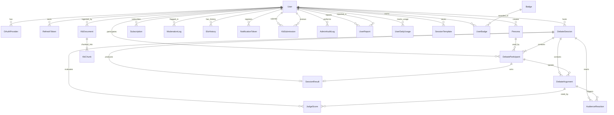

# 🗄️ Database Design Document (Prisma ORM)
## DebateAI — Desain Skema & Arsitektur Basis Data

| Metadata | Keterangan |
|---|---|
| **Versi Dokumen** | 1.0 (Final) |
| **Tanggal** | September 2026 |
| **Target ORM** | Prisma ORM 5.x / 6.x |
| **Basis Data Utama** | PostgreSQL 16 dengan Ekstensi `pgvector` |
| **Referensi Produk** | PRD DebateAI v2.0 & Implementation Plan v1.0 |
| **Status** | Dokumen Desain Teknis (Tanpa Kode Aplikasi Aktif) |

---

## Daftar Isi

1. [Prinsip Desain & Konvensi Prisma](#1-prinsip-desain--konvensi-prisma)
2. [Diagram Relasi Entitas (ERD)](#2-diagram-relasi-entitas-erd)
3. [Penanganan Fitur Khusus PostgreSQL & Prisma](#3-penanganan-fitur-khusus-postgresql--prisma)
4. [Skema Lengkap: `schema.prisma`](#4-skema-lengkap-schemaprisma)
5. [Kamus Data Detail (Data Dictionary)](#5-kamus-data-detail-data-dictionary)
6. [Strategi Indexing & Optimasi Performa](#6-strategi-indexing--optimasi-performa)
7. [Pola Query Prisma & RAG Vector Search](#7-pola-query-prisma--rag-vector-search)
8. [Strategi Migrasi, Seeding, dan Manajemen Siklus Hidup Data](#8-strategi-migrasi-seeding-dan-manajemen-siklus-hidup-data)

---

## 1. Prinsip Desain & Konvensi Prisma

Desain database DebateAI dirancang untuk menjamin integritas data, performa tinggi saat beban debat real-time, skalabilitas RAG vector search, dan kenyamanan developer saat berinteraksi melalui Prisma Client.

### 1.1 Konvensi Penamaan (Mapping)
- **TypeScript / Prisma Model**: Menggunakan format `PascalCase` untuk nama model (misal: `DebateSession`, `JudgeScore`) dan `camelCase` untuk field (misal: `totalRounds`, `createdAt`).
- **PostgreSQL Asli**: Menggunakan format `snake_case` untuk nama tabel (misal: `debate_sessions`) dan nama kolom (misal: `total_rounds`, `created_at`).
- **Penerapan**: Setiap model menggunakan atribut `@@map("nama_tabel_plural")` dan setiap field memetakan kolom database dengan `@map("nama_kolom_snake_case")`.

### 1.2 Identifikasi & Kunci Utama (Primary Key)
- Seluruh tabel menggunakan **UUID v4** sebagai Kunci Utama (`@id @default(uuid())` atau `@default(dbgenerated("gen_random_uuid()"))`).
- Mencegah *ID enumeration attack*, mempermudah distribusi UUID di level client jika diperlukan, dan mendukung arsitektur multi-service tanpa tabrakan ID sekuensial.

### 1.3 Standar Audit & Retensi
- Setiap entitas inti memiliki field audit wajib:
  - `createdAt DateTime @default(now()) @map("created_at")`
  - `updatedAt DateTime @updatedAt @map("updated_at")`
- Tabel entitas sensitif (seperti `User`) menggunakan teknik **Soft Delete** via `deletedAt DateTime? @map("deleted_at")` untuk mematuhi regulasi UU PDP (hak pengguna untuk menghapus akun tanpa merusak integritas foreign key data analitik sesi).

### 1.4 Normalisasi & Denormalisasi Terkontrol
- Relasi 3NF diterapkan pada transaksi data inti: user, persona, sesi, giliran argumen, skor juri, dan reaksi penonton.
- Denormalisasi terkontrol (misal: `total_rounds`, `current_round`, `total_score`, `win_rate`) digunakan untuk mempercepat query tampilan antarmuka (UI Read Optimization) tanpa harus melakukan agregasi berat secara terus-menerus.

---

## 2. Diagram Relasi Entitas (ERD)

Berikut adalah diagram hubungan antar tabel dalam sistem DebateAI:



---

## 3. Penanganan Fitur Khusus PostgreSQL & Prisma

Prisma secara bawaan belum memiliki tipe data native TypeScript untuk tipe `vector` milik pgvector. Oleh karena itu, arsitektur ini menerapkan pendekatan hybrid yang direkomendasikan secara resmi oleh Prisma & PostgreSQL.

### 3.1 Integrasi `pgvector` dalam Prisma
1. Diaktifkan melalui PostgreSQL Extension di dalam database:
   ```sql
   CREATE EXTENSION IF NOT EXISTS vector;
   ```
2. Dalam skema Prisma, tipe embedding didefinisikan menggunakan tipe `Unsupported`:
   ```prisma
   embedding Unsupported("vector(768)")? @map("embedding")
   ```
   *(Catatan: Ukuran dimensi disesuaikan, misalnya `768` untuk Google Gemini `text-embedding-004` atau `1536` untuk OpenAI `text-embedding-3-large`).*
3. Untuk proses vector similarity search (pencarian kemiripan cosine `<=>`), kita memanfaatkan Prisma Typed SQL atau `$queryRaw`.

### 3.2 Penyimpanan Data Semi-Terstruktur (JSONB)
Beberapa komponen AI bersifat polimorfik dan dinamis:
- Rincian bobot penilaian juri (`breakdown` pada `JudgeScore`).
- Kumpulan reaksi emoji penonton & daftar komentar live (`comments` pada `AudienceReaction`).
- Rujukan Knowledge Base yang disuntikkan ke prompt (`kb_refs` pada `DebateArgument`).
Komponen ini disimpan dalam kolom native `Json` (`JSONB` di PostgreSQL) untuk memberikan fleksibilitas tanpa mengorbankan performa query berkat kemampuan indexing GIN pada Postgres.

---

## 4. Skema Lengkap: `schema.prisma`

Berikut adalah cetak biru skema Prisma lengkap yang siap digunakan untuk inisialisasi project:

```prisma
// ============================================================
// KONFIGURASI DATASOURCE & GENERATOR
// ============================================================

datasource db {
  provider   = "postgresql"
  url        = env("DATABASE_URL")
  directUrl  = env("DIRECT_URL")
}

generator client {
  provider        = "prisma-client-js"
  previewFeatures = ["postgresqlExtensions"]
}

// ============================================================
// ENUMERASI SISTEM
// ============================================================

enum Language {
  ID
  EN
}

enum DebateLevel {
  BEGINNER
  INTERMEDIATE
  ADVANCED
  MASTER
}

enum SessionStatus {
  WAITING
  ONGOING
  PAUSED
  DISCONNECTED
  COMPLETED
  CANCELLED
}

enum DebateMode {
  OFFLINE // Melawan AI
  ONLINE  // Melawan pengguna lain
}

enum DebateFormat {
  OXFORD
  KDMI
  BP
  NUDC
  INTERVIEW
  FREE
}

enum DebateCategory {
  POLITICS
  LAW
  ECONOMY
  SOCIAL
  TECHNOLOGY
  EDUCATION
  ENVIRONMENT
  FREE
}

enum ParticipantStance {
  PRO
  CONTRA
  NEUTRAL
}

enum ParticipantRole {
  HOST
  OPPONENT
  OBSERVER
  GOVERNMENT_1
  GOVERNMENT_2
  OPPOSITION_1
  OPPOSITION_2
}

enum AIProvider {
  GEMINI
  OPENAI
  ANTHROPIC
}

enum AIDifficulty {
  EASY
  MEDIUM
  HARD
}

enum ContentType {
  TEXT
  VOICE
}

enum JudgeType {
  LOGIKA
  RETORIKA
  DAMPAK
}

enum ReactionType {
  APPLAUSE
  BOO
  NEUTRAL
  EXCITED
  SKEPTICAL
}

enum SourceType {
  YOUTUBE
  PDF
  WEB
  MANUAL
}

enum SubscriptionPlan {
  MONTHLY
  YEARLY
}

enum SubscriptionStatus {
  ACTIVE
  PENDING
  EXPIRED
  CANCELLED
}

enum ModerationAction {
  WARNED
  FLAGGED
  BLOCKED
}

enum SubmissionStatus {
  PENDING
  APPROVED
  REJECTED
}

enum UserRole {
  USER
  ADMIN
  SUPERADMIN
}

enum ReportReason {
  HATE_SPEECH
  HARASSMENT
  SPAM
  INAPPROPRIATE_CONTENT
  DOXXING
  OTHER
}

enum ReportStatus {
  PENDING
  REVIEWED
  ACTIONED
  DISMISSED
}

// ============================================================
// 1. MODUL PENGGUNA & AUTENTIKASI
// ============================================================

model User {
  id                String       @id @default(uuid()) @db.Uuid
  email             String       @unique @db.VarChar(255)
  passwordHash      String?      @map("password_hash") @db.VarChar(255)
  name              String       @db.VarChar(100)
  avatarUrl         String?      @map("avatar_url") @db.Text
  bio               String?      @db.Text
  preferredLanguage Language     @default(ID) @map("preferred_language")
  debateLevel       DebateLevel  @default(BEGINNER) @map("debate_level")
  eloRating         Int          @default(1000) @map("elo_rating")
  totalSessions     Int          @default(0) @map("total_sessions")
  totalWins         Int          @default(0) @map("total_wins")
  isPro             Boolean      @default(false) @map("is_pro")
  role              UserRole     @default(USER)
  warningCount      Int          @default(0) @map("warning_count")
  isBanned          Boolean      @default(false) @map("is_banned")
  isSuspended       Boolean      @default(false) @map("is_suspended")
  suspendedUntil    DateTime?    @map("suspended_until")
  bannedAt          DateTime?    @map("banned_at")
  totalPoints       Int          @default(0) @map("total_points")
  createdAt         DateTime     @default(now()) @map("created_at")
  updatedAt         DateTime     @updatedAt @map("updated_at")
  deletedAt         DateTime?    @map("deleted_at")

  // Relasi
  oauthProviders    OAuthProvider[]
  refreshTokens     RefreshToken[]
  personas          Persona[]
  hostedSessions    DebateSession[]       @relation("SessionHost")
  participations    DebateParticipant[]
  subscriptions     Subscription[]
  moderationLogs    ModerationLog[]
  eloHistories      EloHistory[]
  notificationTokens NotificationToken[]
  kbSubmissions     KbSubmission[]        @relation("UserSubmissions")
  reviewedSubmissions KbSubmission[]      @relation("AdminReviews")
  ingestedDocuments KbDocument[]          @relation("AdminIngests")
  adminAuditLogs    AdminAuditLog[]       @relation("AdminActions")
  reportsMade       UserReport[]          @relation("ReportsMade")
  reportsReceived   UserReport[]          @relation("ReportsReceived")
  reportReviews     UserReport[]          @relation("ReportReviews")
  dailyUsage        UserDailyUsage[]
  sessionTemplates  SessionTemplate[]
  badges            UserBadge[]

  @@index([email])
  @@index([eloRating])
  @@index([role])
  @@map("users")
}

model OAuthProvider {
  id         String   @id @default(uuid()) @db.Uuid
  userId     String   @map("user_id") @db.Uuid
  provider   String   @db.VarChar(50) // "google", "apple"
  providerId String   @map("provider_id") @db.VarChar(255)
  createdAt  DateTime @default(now()) @map("created_at")

  user       User     @relation(fields: [userId], references: [id], onDelete: Cascade)

  @@unique([provider, providerId])
  @@index([userId])
  @@map("oauth_providers")
}

model RefreshToken {
  id         String   @id @default(uuid()) @db.Uuid
  userId     String   @map("user_id") @db.Uuid
  tokenHash  String   @unique @map("token_hash") @db.VarChar(255)
  expiresAt  DateTime @map("expires_at")
  createdAt  DateTime @default(now()) @map("created_at")

  user       User     @relation(fields: [userId], references: [id], onDelete: Cascade)

  @@index([userId])
  @@map("refresh_tokens")
}

// ============================================================
// 2. MODUL PERSONA & ROLEPLAY
// ============================================================

model Persona {
  id             String             @id @default(uuid()) @db.Uuid
  userId         String?            @map("user_id") @db.Uuid // null jika template global/sistem
  name           String             @db.VarChar(100)
  description    String             @db.Text
  speakingStyle  String?            @map("speaking_style") @db.Text
  stanceDefault  ParticipantStance? @default(NEUTRAL) @map("stance_default")
  language       Language           @default(ID)
  avatarUrl      String?            @map("avatar_url") @db.Text
  isTemplate     Boolean            @default(false) @map("is_template")
  isActive       Boolean            @default(true) @map("is_active")
  createdAt      DateTime           @default(now()) @map("created_at")
  updatedAt      DateTime           @updatedAt @map("updated_at")

  user           User?              @relation(fields: [userId], references: [id], onDelete: Cascade)
  participants   DebateParticipant[]

  @@index([userId])
  @@index([isTemplate, isActive])
  @@map("personas")
}

// ============================================================
// 3. MODUL SESI DEBAT & ARENA
// ============================================================

model DebateMotion {
  id          String          @id @default(uuid()) @db.Uuid
  text        String          @db.Text
  category    DebateCategory
  format      DebateFormat?
  language    Language        @default(ID)
  difficulty  AIDifficulty    @default(MEDIUM)
  source      String?         @db.VarChar(100) // "KDMI 2024", "NUDC 2023", "WUDC 2025"
  isActive    Boolean         @default(true) @map("is_active")
  usageCount  Int             @default(0) @map("usage_count")
  createdAt   DateTime        @default(now()) @map("created_at")

  @@index([category, language])
  @@index([isActive])
  @@map("debate_motions")
}

model SessionTemplate {
  id           String         @id @default(uuid()) @db.Uuid
  userId       String         @map("user_id") @db.Uuid
  name         String         @db.VarChar(100)
  topic        String?        @db.Text
  category     DebateCategory @default(FREE)
  format       DebateFormat   @default(FREE)
  totalRounds  Int            @default(3) @map("total_rounds")
  timePerTurn  Int            @default(300) @map("time_per_turn")
  aiProvider   AIProvider     @default(GEMINI) @map("ai_provider")
  aiDifficulty AIDifficulty?  @map("ai_difficulty")
  personaId    String?        @map("persona_id") @db.Uuid
  isJudged     Boolean        @default(true) @map("is_judged")
  hasAudience  Boolean        @default(true) @map("has_audience")
  createdAt    DateTime       @default(now()) @map("created_at")
  updatedAt    DateTime       @updatedAt @map("updated_at")

  user         User           @relation(fields: [userId], references: [id], onDelete: Cascade)

  @@index([userId])
  @@map("session_templates")
}

model DebateSession {
  id            String             @id @default(uuid()) @db.Uuid
  title         String?            @db.VarChar(255)
  topic         String             @db.Text
  motion        String?            @db.Text
  format        DebateFormat       @default(FREE)
  category      DebateCategory     @default(FREE)
  language      Language           @default(ID)
  status        SessionStatus      @default(WAITING)
  mode          DebateMode         @default(OFFLINE)
  totalRounds   Int                @default(3) @map("total_rounds")
  currentRound  Int                @default(1) @map("current_round")
  currentTurn   Int                @default(1) @map("current_turn")
  timePerTurn   Int                @default(300) @map("time_per_turn") // Dalam detik
  hostUserId    String             @map("host_user_id") @db.Uuid
  roomCode      String?            @unique @map("room_code") @db.VarChar(8)
  aiProvider    AIProvider         @default(GEMINI) @map("ai_provider")
  isJudged      Boolean            @default(true) @map("is_judged")
  hasAudience   Boolean            @default(true) @map("has_audience")
  startedAt     DateTime?          @map("started_at")
  endedAt       DateTime?          @map("ended_at")
  createdAt     DateTime           @default(now()) @map("created_at")
  updatedAt     DateTime           @updatedAt @map("updated_at")

  hostUser      User               @relation("SessionHost", fields: [hostUserId], references: [id], onDelete: Restrict)
  participants  DebateParticipant[]
  arguments     DebateArgument[]
  judgeScores   JudgeScore[]
  audienceReactions AudienceReaction[]
  result        SessionResult?

  @@index([hostUserId])
  @@index([status])
  @@index([roomCode])
  @@index([category])
  @@map("debate_sessions")
}

model DebateParticipant {
  id           String            @id @default(uuid()) @db.Uuid
  sessionId    String            @map("session_id") @db.Uuid
  userId       String?           @map("user_id") @db.Uuid // null jika participant AI
  personaId    String?           @map("persona_id") @db.Uuid
  personaName  String            @map("persona_name") @db.VarChar(100)
  stance       ParticipantStance
  role         ParticipantRole   @default(HOST)
  isAi         Boolean           @default(false) @map("is_ai")
  aiDifficulty AIDifficulty?     @map("ai_difficulty")
  joinOrder    Int               @default(1) @map("join_order")
  lastActiveAt DateTime?         @map("last_active_at")
  joinedAt     DateTime          @default(now()) @map("joined_at")

  session      DebateSession     @relation(fields: [sessionId], references: [id], onDelete: Cascade)
  user         User?             @relation(fields: [userId], references: [id], onDelete: SetNull)
  persona      Persona?          @relation(fields: [personaId], references: [id], onDelete: SetNull)
  arguments    DebateArgument[]
  wonResults   SessionResult[]   @relation("WinnerParticipant")

  @@unique([sessionId, joinOrder])
  @@index([sessionId])
  @@index([userId])
  @@map("debate_participants")
}

model DebateArgument {
  id            String             @id @default(uuid()) @db.Uuid
  sessionId     String             @map("session_id") @db.Uuid
  participantId String             @map("participant_id") @db.Uuid
  content       String             @db.Text
  contentType   ContentType        @default(TEXT) @map("content_type")
  audioUrl      String?            @map("audio_url") @db.Text
  roundNumber   Int                @map("round_number")
  turnNumber    Int                @map("turn_number")
  durationSec   Int?               @map("duration_sec")
  kbRefs        Json?              @map("kb_refs") // List chunk referensi: [{ documentTitle, snippet }]
  createdAt     DateTime           @default(now()) @map("created_at")

  session       DebateSession      @relation(fields: [sessionId], references: [id], onDelete: Cascade)
  participant   DebateParticipant  @relation(fields: [participantId], references: [id], onDelete: Cascade)
  judgeScores   JudgeScore[]
  reactions     AudienceReaction[]

  @@index([sessionId, turnNumber])
  @@index([participantId])
  @@map("debate_arguments")
}

// ============================================================
// 4. MODUL EVALUASI & PENILAIAN AI (JURI & PENONTON)
// ============================================================

model JudgeScore {
  id                 String         @id @default(uuid()) @db.Uuid
  sessionId          String         @map("session_id") @db.Uuid
  argumentId         String         @map("argument_id") @db.Uuid
  judgeType          JudgeType      @map("judge_type")
  argumentStrength   Int            @map("argument_strength") // 0-100
  factDataUsage      Int            @map("fact_data_usage")   // 0-100
  rhetoricTechnique  Int            @map("rhetoric_technique")// 0-100
  responsiveness     Int            @map("responsiveness")    // 0-100
  clarityStructure   Int            @map("clarity_structure") // 0-100
  totalScore         Decimal        @map("total_score") @db.Decimal(5, 2)
  summary            String         @db.Text
  highlightsPositive Json           @map("highlights_positive") // String array: ["Poin A", "Poin B"]
  highlightsNegative Json           @map("highlights_negative") // String array: ["Kelemahan A"]
  fallacyDetected    String?        @map("fallacy_detected") @db.VarChar(100)
  suggestion         String?        @db.Text
  createdAt          DateTime       @default(now()) @map("created_at")

  session            DebateSession  @relation(fields: [sessionId], references: [id], onDelete: Cascade)
  argument           DebateArgument @relation(fields: [argumentId], references: [id], onDelete: Cascade)

  @@index([sessionId])
  @@index([argumentId])
  @@index([judgeType])
  @@map("judge_scores")
}

model AudienceReaction {
  id           String         @id @default(uuid()) @db.Uuid
  sessionId    String         @map("session_id") @db.Uuid
  argumentId   String         @map("argument_id") @db.Uuid
  reactionType ReactionType   @map("reaction_type")
  intensity    Int            @default(50) // 0-100
  comments     Json?          // Array of strings: ["Argumen tajam!", "Data kurang kuat..."]
  createdAt    DateTime       @default(now()) @map("created_at")

  session      DebateSession  @relation(fields: [sessionId], references: [id], onDelete: Cascade)
  argument     DebateArgument @relation(fields: [argumentId], references: [id], onDelete: Cascade)

  @@index([sessionId])
  @@index([argumentId])
  @@map("audience_reactions")
}

model SessionResult {
  id                  String             @id @default(uuid()) @db.Uuid
  sessionId           String             @unique @map("session_id") @db.Uuid
  winnerParticipantId String?            @map("winner_participant_id") @db.Uuid
  isDraw              Boolean            @default(false) @map("is_draw")
  finalScores         Json               @map("final_scores") // Agregasi skor per aspek dan per peserta
  summary             String             @db.Text
  keyMoments          Json?              @map("key_moments") // Momen paling menentukan dalam debat
  suggestions         Json?              // Rekomendasi latihan lanjutan
  createdAt           DateTime           @default(now()) @map("created_at")

  session             DebateSession      @relation(fields: [sessionId], references: [id], onDelete: Cascade)
  winnerParticipant   DebateParticipant? @relation("WinnerParticipant", fields: [winnerParticipantId], references: [id], onDelete: SetNull)

  @@map("session_results")
}

// ============================================================
// 5. MODUL KNOWLEDGE BASE & RAG (PGVECTOR)
// ============================================================

model KbDocument {
  id           String       @id @default(uuid()) @db.Uuid
  title        String       @db.VarChar(500)
  sourceType   SourceType   @map("source_type")
  sourceUrl    String?      @map("source_url") @db.Text
  language     Language     @default(ID)
  topicTags    String[]     @map("topic_tags")
  personaTags  String[]     @map("persona_tags")
  totalChunks  Int          @default(0) @map("total_chunks")
  isActive     Boolean      @default(true) @map("is_active")
  ingestedById String?      @map("ingested_by_id") @db.Uuid
  createdAt    DateTime     @default(now()) @map("created_at")
  updatedAt    DateTime     @updatedAt @map("updated_at")

  ingestedBy   User?        @relation("AdminIngests", fields: [ingestedById], references: [id], onDelete: SetNull)
  chunks       KbChunk[]

  @@index([sourceType])
  @@index([language])
  @@index([isActive])
  @@map("kb_documents")
}

model KbChunk {
  id          String                      @id @default(uuid()) @db.Uuid
  documentId  String                      @map("document_id") @db.Uuid
  content     String                      @db.Text
  contentHash String                      @unique @map("content_hash") @db.VarChar(64)
  chunkIndex  Int                         @map("chunk_index")
  tokenCount  Int?                        @map("token_count")
  isActive    Boolean                     @default(true) @map("is_active")
  createdAt   DateTime                    @default(now()) @map("created_at")
  
  // Penanganan tipe native pgvector di Prisma:
  embedding   Unsupported("vector(768)")? @map("embedding")

  document    KbDocument                  @relation(fields: [documentId], references: [id], onDelete: Cascade)

  @@index([documentId])
  @@index([isActive])
  @@map("kb_chunks")
}

// ============================================================
// 6. MODUL MONETISASI, ANALITIK & OPERASIONAL
// ============================================================

model Subscription {
  id                    String             @id @default(uuid()) @db.Uuid
  userId                String             @map("user_id") @db.Uuid
  plan                  SubscriptionPlan
  status                SubscriptionStatus @default(PENDING)
  midtransOrderId       String?            @unique @map("midtrans_order_id") @db.VarChar(100)
  midtransTransactionId String?            @map("midtrans_transaction_id") @db.VarChar(100)
  currentPeriodStart    DateTime           @map("current_period_start")
  currentPeriodEnd      DateTime           @map("current_period_end")
  createdAt             DateTime           @default(now()) @map("created_at")
  updatedAt             DateTime           @updatedAt @map("updated_at")

  user                  User               @relation(fields: [userId], references: [id], onDelete: Cascade)

  @@index([userId])
  @@index([status])
  @@map("subscriptions")
}

model ModerationLog {
  id         String           @id @default(uuid()) @db.Uuid
  userId     String?          @map("user_id") @db.Uuid
  sessionId  String?          @map("session_id") @db.Uuid
  content    String           @db.Text
  flagReason String           @map("flag_reason") @db.VarChar(100)
  action     ModerationAction @default(FLAGGED)
  createdAt  DateTime         @default(now()) @map("created_at")

  user       User?            @relation(fields: [userId], references: [id], onDelete: SetNull)

  @@index([userId])
  @@index([action])
  @@map("moderation_logs")
}

model UserReport {
  id           String       @id @default(uuid()) @db.Uuid
  reporterId   String       @map("reporter_id") @db.Uuid
  reportedId   String?      @map("reported_id") @db.Uuid
  sessionId    String?      @map("session_id") @db.Uuid
  argumentId   String?      @map("argument_id") @db.Uuid
  reason       ReportReason
  description  String?      @db.Text
  status       ReportStatus @default(PENDING)
  reviewedById String?      @map("reviewed_by_id") @db.Uuid
  reviewedAt   DateTime?    @map("reviewed_at")
  createdAt    DateTime     @default(now()) @map("created_at")

  reporter     User         @relation("ReportsMade", fields: [reporterId], references: [id])
  reported     User?        @relation("ReportsReceived", fields: [reportedId], references: [id])
  reviewer     User?        @relation("ReportReviews", fields: [reviewedById], references: [id])

  @@index([reportedId])
  @@index([status])
  @@index([createdAt])
  @@map("user_reports")
}

model AdminAuditLog {
  id          String   @id @default(uuid()) @db.Uuid
  adminId     String   @map("admin_id") @db.Uuid
  action      String   @db.VarChar(100) // "ban_user", "delete_kb_doc", "approve_submission", "update_config"
  targetType  String   @map("target_type") @db.VarChar(50) // "user", "session", "kb_document", "persona"
  targetId    String?  @map("target_id") @db.Uuid
  metadata    Json?    // Detail tambahan: { reason, old_value, new_value }
  ipAddress   String?  @map("ip_address") @db.VarChar(45)
  createdAt   DateTime @default(now()) @map("created_at")

  admin       User     @relation("AdminActions", fields: [adminId], references: [id])

  @@index([adminId])
  @@index([action])
  @@index([createdAt])
  @@map("admin_audit_logs")
}

model AiUsageLog {
  id           String      @id @default(uuid()) @db.Uuid
  sessionId    String?     @map("session_id") @db.Uuid
  provider     AIProvider
  modelName    String      @map("model_name") @db.VarChar(100)
  promptTokens Int         @map("prompt_tokens")
  compTokens   Int         @map("comp_tokens")
  totalCostUsd Decimal     @map("total_cost_usd") @db.Decimal(10, 6)
  purpose      String      @db.VarChar(50) // "opponent", "judge_logika", dll.
  createdAt    DateTime    @default(now()) @map("created_at")

  @@index([sessionId])
  @@index([provider])
  @@index([createdAt])
  @@map("ai_usage_logs")
}

model EloHistory {
  id         String   @id @default(uuid()) @db.Uuid
  userId     String   @map("user_id") @db.Uuid
  sessionId  String   @map("session_id") @db.Uuid
  oldRating  Int      @map("old_rating")
  newRating  Int      @map("new_rating")
  createdAt  DateTime @default(now()) @map("created_at")

  user       User     @relation(fields: [userId], references: [id], onDelete: Cascade)

  @@index([userId])
  @@map("elo_histories")
}

model NotificationToken {
  id         String   @id @default(uuid()) @db.Uuid
  userId     String   @map("user_id") @db.Uuid
  token      String   @unique @db.VarChar(500)
  deviceType String   @map("device_type") @db.VarChar(20) // "android", "ios", "web"
  updatedAt  DateTime @updatedAt @map("updated_at")

  user       User     @relation(fields: [userId], references: [id], onDelete: Cascade)

  @@index([userId])
  @@map("notification_tokens")
}

model UserDailyUsage {
  id           String   @id @default(uuid()) @db.Uuid
  userId       String   @map("user_id") @db.Uuid
  usageDate    DateTime @map("usage_date") @db.Date
  sessionCount Int      @default(0) @map("session_count")
  aiCallCount  Int      @default(0) @map("ai_call_count")
  createdAt    DateTime @default(now()) @map("created_at")

  user         User     @relation(fields: [userId], references: [id], onDelete: Cascade)

  @@unique([userId, usageDate])
  @@index([usageDate])
  @@map("user_daily_usage")
}

model KbSubmission {
  id          String           @id @default(uuid()) @db.Uuid
  userId      String           @map("user_id") @db.Uuid
  title       String           @db.VarChar(255)
  sourceUrl   String           @map("source_url") @db.Text
  description String?          @db.Text
  status      SubmissionStatus @default(PENDING)
  reviewerId  String?          @map("reviewer_id") @db.Uuid
  reviewNote  String?          @map("review_note") @db.Text
  createdAt   DateTime         @default(now()) @map("created_at")
  updatedAt   DateTime         @updatedAt @map("updated_at")

  submitter   User             @relation("UserSubmissions", fields: [userId], references: [id], onDelete: Cascade)
  reviewer    User?            @relation("AdminReviews", fields: [reviewerId], references: [id], onDelete: SetNull)

  @@index([userId])
  @@index([status])
  @@map("kb_submissions")
}

// ============================================================
// 7. MODUL GAMIFIKASI & PENCAPAIAN
// ============================================================

model Badge {
  id          String      @id @default(uuid()) @db.Uuid
  code        String      @unique @db.VarChar(50)  // "first_debate", "win_streak_5", "kb_contributor"
  name        String      @db.VarChar(100)
  description String      @db.Text
  iconUrl     String?     @map("icon_url") @db.Text
  category    String      @default("general") @db.VarChar(50) // "general", "streak", "social", "mastery"
  createdAt   DateTime    @default(now()) @map("created_at")

  userBadges  UserBadge[]

  @@map("badges")
}

model UserBadge {
  id        String   @id @default(uuid()) @db.Uuid
  userId    String   @map("user_id") @db.Uuid
  badgeId   String   @map("badge_id") @db.Uuid
  earnedAt  DateTime @default(now()) @map("earned_at")

  user      User     @relation(fields: [userId], references: [id], onDelete: Cascade)
  badge     Badge    @relation(fields: [badgeId], references: [id])

  @@unique([userId, badgeId])
  @@index([userId])
  @@map("user_badges")
}
```

---

## 5. Kamus Data Detail (Data Dictionary)

Berikut adalah dokumentasi semantik tiap tabel dan atribut penting dalam sistem:

### 5.1 `users`
Menyimpan identitas akun pengguna, level kecakapan debat, rating kompetitif, dan status langganan.
- `id` (UUID): Identitas unik pengguna.
- `email` (VarChar 255): Alamat surel unik untuk autentikasi.
- `password_hash` (VarChar 255): Hash password bcrypt (opsional jika login murni OAuth).
- `elo_rating` (Int, Default: 1000): Skor performa debat kompetitif online.
- `is_pro` (Boolean, Default: false): Flag akun premium untuk bypass limitasi sesi dan voice feature.
- `role` (Enum UserRole, Default: USER): Hak akses pengguna dalam sistem (USER, ADMIN, SUPERADMIN).
- `warning_count` (Int, Default: 0): Akumulasi teguran pelanggaran moderasi (3 teguran = suspensi).
- `is_banned` (Boolean, Default: false): Flag pemblokiran permanen akun pengguna.
- `is_suspended` (Boolean, Default: false): Flag penangguhan sementara akun pengguna.
- `suspended_until` (DateTime, Nullable): Batas waktu masa suspensi akun berakhir.
- `total_points` (Int, Default: 0): Poin akumulasi gamifikasi dari aktivitas debat dan penyelesaian tantangan.
- `deleted_at` (DateTime, Nullable): Timestamp soft delete demi privasi pengguna (UU PDP).

### 5.2 `personas`
Menyimpan entitas kepribadian/tokoh yang dapat dilakonkan oleh pengguna maupun AI.
- `user_id` (UUID, Nullable): ID pembuat persona. Bernilai `null` untuk persona resmi bawaan sistem.
- `speaking_style` (Text): Parameter instruksi gaya bicara yang disuntikkan ke system prompt AI.
- `is_template` (Boolean): Bernilai `true` jika persona dapat dipilih publik di menu library.

### 5.3 `debate_sessions`
Tabel pengendali utama arena debat, menyimpan status, topik, konfigurasi waktu, dan aturan format.
- `format` (Enum DebateFormat): Aturan debat (Oxford, KDMI, BP, NUDC, Interview, Free).
- `category` (Enum DebateCategory): Kategori topik debat untuk klasifikasi dan matchmaking.
- `mode` (Enum DebateMode): Menentukan apakah sesi berjalan offline (vs AI) atau online (vs User).
- `room_code` (VarChar 8, Nullable): Kode 6-8 digit unik untuk matchmaking/invite room online.
- `ai_provider` (Enum AIProvider): Engine AI yang dialokasikan (Gemini, OpenAI, Anthropic).

### 5.4 `debate_participants`
Daftar peserta yang terikat dalam satu sesi debat.
- `is_ai` (Boolean): Penanda apakah entitas peserta digerakkan oleh bot AI atau manusia.
- `stance` (Enum ParticipantStance): Posisi argumen (`PRO`, `CONTRA`, `NEUTRAL`).
- `join_order` (Int): Urutan giliran bicara dalam format debat.

### 5.5 `debate_arguments`
Rekaman butir pernyataan/argumen yang diutarakan peserta pada setiap putaran.
- `content` (Text): Teks transkrip lengkap dari pernyataan peserta.
- `content_type` (Enum ContentType): `TEXT` atau `VOICE`.
- `kb_refs` (JSONB): Metadata chunk knowledge base yang dijadikan referensi grounding saat argumen dihasilkan.

### 5.6 `judge_scores`
Hasil audit objektif yang dihasilkan oleh para agen Juri AI per argumen yang masuk.
- `judge_type` (Enum JudgeType): `LOGIKA`, `RETORIKA`, atau `DAMPAK`.
- `argument_strength` s/d `clarity_structure` (Int, 0-100): 5 dimensi rubrik debat standar.
- `fallacy_detected` (VarChar 100): Nama logical fallacy jika terdeteksi oleh juri logika.

### 5.7 `kb_chunks`
Pecahan dokumen debat (±500 token) beserta representasi semantik vektornya untuk RAG.
- `content_hash` (VarChar 64): SHA-256 hash untuk mencegah duplikasi chunk di database.
- `embedding` (vector): Vektor floating-point berdimensi 768 untuk similarity search pgvector.

### 5.8 `admin_audit_logs`
Mencatat seluruh aksi yang dilakukan oleh admin/superadmin dalam sistem untuk keperluan audit trail.
- `admin_id` (UUID): ID admin yang melakukan aksi.
- `action` (VarChar 100): Nama aksi yang dilakukan (contoh: "ban_user", "delete_kb_doc", "approve_submission", "update_config").
- `target_type` (VarChar 50): Tipe entitas yang menjadi target aksi.
- `target_id` (UUID, Nullable): ID entitas target.
- `metadata` (JSONB): Detail kontekstual aksi (reason, old_value, new_value).
- `ip_address` (VarChar 45): Alamat IP admin saat melakukan aksi.

### 5.9 `user_reports`
Mencatat pelaporan pelanggaran konten atau perilaku pengguna lain dalam arena debat.
- `reporter_id` (UUID): ID pengguna yang membuat laporan.
- `reported_id` (UUID, Nullable): ID pengguna yang dilaporkan jika berlaku.
- `reason` (Enum ReportReason): Alasan pelaporan (hate speech, harassment, spam, dll).
- `status` (Enum ReportStatus): Status investigasi laporan (`PENDING`, `REVIEWED`, `ACTIONED`, `DISMISSED`).

### 5.10 `debate_motions`
Menyimpan katalog mosi debat terkurasi untuk rekomendasi, filtering, dan seeding kompetisi.
- `text` (Text): Kalimat mosi debat (misal: "Dewan ini akan mewajibkan adopsi AI pada kurikulum nasional").
- `category` (Enum DebateCategory): Kategori topik (POLITICS, LAW, ECONOMY, dll).
- `difficulty` (Enum AIDifficulty): Estimasi tingkat kesulitan debat.
- `source` (VarChar 100): Asal usul mosi (KDMI, NUDC, WUDC).

### 5.11 `session_templates`
Menyimpan preset konfigurasi ruangan debat favorit milik pengguna untuk instanisasi cepat.
- `user_id` (UUID): Pemilik template.
- `name` (VarChar 100): Nama preset template.
- `total_rounds`, `time_per_turn`, `format`, `category`: Parameter preset sesi.

### 5.12 `badges` & `user_badges`
Menyimpan katalog lencana pencapaian gamifikasi dan riwayat perolehan lencana oleh pengguna.
- `code` (VarChar 50): Kode unik achievement (`first_debate`, `win_streak_5`, dll).
- `user_id` & `badge_id`: Relasi many-to-many antara user dan badge yang diperoleh.
- `earned_at` (DateTime): Waktu pencapaian diraih.

---

## 6. Strategi Indexing & Optimasi Performa

Untuk menjaga latensi query tetap di bawah 200ms saat ratusan sesi berlangsung bersamaan, strategi indexing berikut wajib diterapkan:

### 6.1 Indexing B-Tree Konvensional
- **Pencarian Sesi Aktif**: `idx_debate_sessions_host` dan `idx_debate_sessions_room_code`.
- **Urutan Giliran Argumen**: Composite index `@@index([sessionId, turnNumber])` pada `debate_arguments` memastikan pengurutan kronologis transkrip instan tanpa full table scan.
- **Relasi Juri**: `@@index([argumentId])` mempercepat agregasi skor saat slide kartu juri ditampilkan di UI.

### 6.2 Indexing Vektor (IVFFlat vs HNSW pada `kb_chunks`)
Untuk kolom `embedding`, PostgreSQL membutuhkan index khusus vector similarity:

```sql
-- Dijalankan via file migrasi kustom prisma (migrations/xxxx_init_vector_idx/migration.sql):
CREATE INDEX idx_kb_chunks_embedding_cosine 
ON kb_chunks 
USING ivfflat (embedding vector_cosine_ops) 
WITH (lists = 100);
```

> **Catatan Rekomendasi**:
> - Pada tahap MVP (Fase 1–2, < 100.000 chunks), **IVFFlat** sangat cepat dibangun dan hemat memori.
> - Pada tahap Scale (Fase 3–4, > 500.000 chunks), index dapat ditingkatkan ke **HNSW** (`USING hnsw (embedding vector_cosine_ops)`) untuk pencarian dengan recall lebih tinggi dan latensi di bawah 10ms.

---

## 7. Pola Query Prisma & RAG Vector Search

### 7.1 Pola Query Transaksional Submit Argumen
Saat pengguna mengirim argumen dalam sesi vs AI, sistem melakukan transaksi atomik berikut:

```typescript
// services/debate.service.ts
export async function submitUserArgument(
  sessionId: string,
  participantId: string,
  content: string,
  turnNumber: number,
  roundNumber: number
) {
  return await prisma.$transaction(async (tx) => {
    // 1. Simpan argumen user
    const userArg = await tx.debateArgument.create({
      data: {
        sessionId,
        participantId,
        content,
        turnNumber,
        roundNumber,
        contentType: 'TEXT',
      },
    });

    // 2. Update progres sesi saat ini
    await tx.debateSession.update({
      where: { id: sessionId },
      data: {
        currentTurn: turnNumber + 1,
      },
    });

    return userArg;
  });
}
```

### 7.2 Pola Query RAG Vector Retrieval (Raw Query Prisma)
Karena Prisma tidak mendukung operator `<=>` secara fluent API, pemanggilan similarity search dilakukan melalui `$queryRaw`:

```typescript
// services/rag.service.ts
import { Prisma } from '@prisma/client';
import { prisma } from '../lib/prisma';

export interface RetrievedChunk {
  id: string;
  documentTitle: string;
  content: string;
  similarity: number;
}

export async function searchKnowledgeBase(
  embeddingArray: number[],
  topK = 5,
  threshold = 0.75
): Promise<RetrievedChunk[]> {
  const vectorString = `[${embeddingArray.join(',')}]`;

  const results = await prisma.$queryRaw<RetrievedChunk[]>(Prisma.sql`
    SELECT 
      c.id,
      d.title AS "documentTitle",
      c.content,
      1 - (c.embedding <=> ${vectorString}::vector) AS similarity
    FROM kb_chunks c
    JOIN kb_documents d ON c.document_id = d.id
    WHERE c.is_active = true
      AND d.is_active = true
      AND (1 - (c.embedding <=> ${vectorString}::vector)) >= ${threshold}
    ORDER BY c.embedding <=> ${vectorString}::vector ASC
    LIMIT ${topK};
  `);

  return results;
}
```

---

## 8. Strategi Migrasi, Seeding, dan Manajemen Siklus Hidup Data

### 8.1 Alur Kerja Migrasi
1. **Pembuatan Migrasi**:
   ```bash
   npx prisma migrate dev --name init_core_schema
   ```
2. **Injeksi Ekstensi Postgres Manual**:
   Pada file migrasi SQL pertama yang dihasilkan Prisma di folder `prisma/migrations/`, tambahkan perintah berikut di baris paling atas:
   ```sql
   CREATE EXTENSION IF NOT EXISTS "uuid-ossp";
   CREATE EXTENSION IF NOT EXISTS vector;
   ```
3. **Deployment ke Lingkungan Staging & Production**:
   ```bash
   npx prisma migrate deploy
   ```

### 8.2 Seeding Awal (`prisma/seed.ts`)
Database wajib diisi data acuan dasar saat pertama kali dibuat:
1. **10 Template Persona Default Bahasa Indonesia**:
   - Presiden Republik Indonesia
   - Menteri Keuangan
   - Hakim Mahkamah Konstitusi
   - Aktivis Lingkungan Hidup
   - CEO Startup Teknologi
   - Jaksa Penuntut KPK
   - Anggota Dewan Perwakilan Rakyat
   - Rektor Perguruan Tinggi
   - Jurnalis Investigatif
   - Pengacara Hak Asasi Manusia
2. **10 Template Persona Default Bahasa Inggris**:
   - US President, Harvard Professor, UN Diplomat, Tech CEO, Human Rights Lawyer, dll.
3. **Mosi Debat Populer (KDMI/NUDC)**:
   - 20 mosi terstandarisasi untuk rekomendasi cepat saat pengguna baru membuat sesi.

### 8.3 Retensi & Kebijakan Arsip
- **Data Argumen Suara (Audio)**: URL rekaman di Cloudflare R2 dibersihkan setelah 90 hari untuk pengguna free via scheduled cron job.
- **Log Pemakaian AI (`ai_usage_logs`)**: Diringkas menjadi statistik agregat bulanan setelah 180 hari untuk menghemat kapasitas storage.

---

*Dokumen Perancangan Database ini siap diimplementasikan langsung ke file `schema.prisma` pada saat fase pengkodean backend dimulai.*
